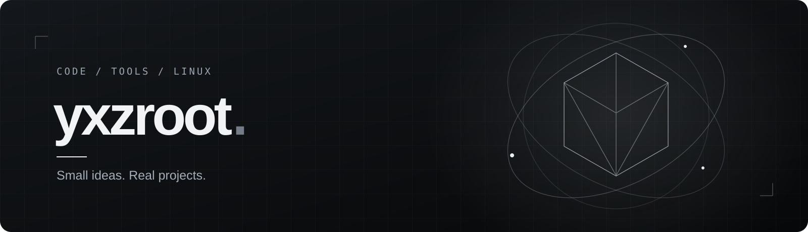

<h2 align="center">Hey, I'm yxzroot.</h2>

Linux tools, desktop apps, and the occasional game project. I like making useful things with a little personality.

---

### A little about me

My GitHub is a mix of things I want to use myself: terminal utilities, small desktop apps, and experiments with games and visuals. I enjoy giving practical tools a clean interface and a bit of character.

- **At home in:** Linux and the terminal
- **Building with:** Python, Java, and C++
- **My approach:** start with an idea, make it work, keep improving it

### Things I've been building

| Project | What it does |
| :--- | :--- |
| [GhostShell](https://github.com/yxzroot/GhostShell) | Lightweight Linux system monitor in C++17 and ncurses. |
| [terminal-time-machine](https://github.com/yxzroot/terminal-time-machine) | A small filesystem time machine for Linux. |
| [drop-once](https://github.com/yxzroot/drop-once) | One-time local file and text sharing across desktops. |
| [Mink](https://github.com/yxzroot/Mink) | An animated terminal companion and MPRIS music controller. |
| [pack-vault](https://github.com/yxzroot/pack-vault) | An animated, cross-platform Minecraft resource pack manager. |
| [Phantom Client](https://github.com/yxzroot/Phantom-Client) | A Minecraft 1.8.9 client project with custom visuals and controls. |

[See all my repositories →](https://github.com/yxzroot?tab=repositories)

### Languages & tools

  
  
  
  
  

---

Always something else to build.

